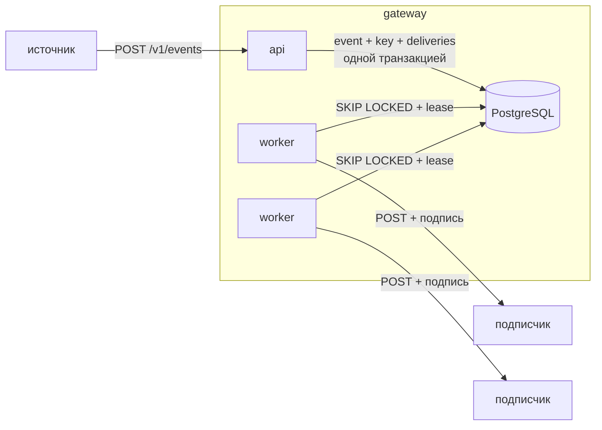
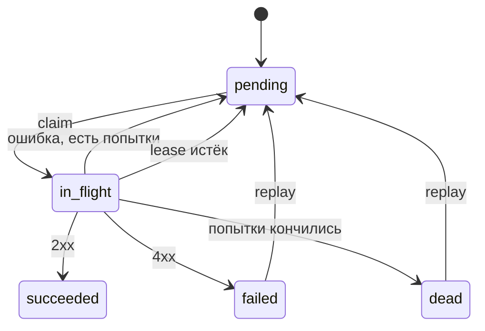

# Webhook Delivery Gateway

Сервис принимает события от другого приложения и доставляет их подписчикам по HTTP.
Подпись HMAC, ретраи с backoff, dead-letter, replay, circuit breaker на каждый endpoint.
Отдельного брокера нет, очередь живёт в PostgreSQL (`FOR UPDATE SKIP LOCKED`)

Python 3.12, FastAPI, SQLAlchemy 2 (async + asyncpg), Alembic, httpx, PostgreSQL 16,
prometheus-client, structlog. Тесты на pytest + testcontainers, uv, ruff, mypy --strict

## Запуск

```bash
docker compose up --build -d     # postgres, миграции, api и 2 воркера
curl localhost:8000/ready
```

| | Make | PowerShell |
|---|---|---|
| поднять | `make up` | `.\scripts\dev.ps1 up` |
| миграции | `make migrate` | `.\scripts\dev.ps1 migrate` |
| тесты | `make test` | `.\scripts\dev.ps1 test` |
| линтеры | `make lint` | `.\scripts\dev.ps1 lint` |

Миграции сам сервис не накатывает, для этого в compose есть отдельный одноразовый `migrate`

Интеграционные тесты поднимают `postgres:16-alpine` через testcontainers. Без Docker можно
указать любой живой postgres: `WG_TEST_DATABASE_URL=postgresql+asyncpg://postgres@localhost:5432/postgres`
(тесты создают себе отдельную БД и потом удаляют её)

## Как устроено



`src/webhook_gateway`:

- `api/`: роутеры, схемы, ошибки, DI
- `services/`: сценарии и транзакции
- `repositories/`: весь SQL
- `worker/`: цикл воркера и HTTP-отправка
- `domain/`: backoff, классификация ответов, подпись, breaker (без I/O)

Время везде берётся из `Clock`, поэтому в тестах нет `sleep`, вместо него `FakeClock`

### Статусы доставки



### Что гарантируется

- **At-least-once, дубли возможны.** Если воркер упал после 2xx, но до записи результата,
  через `WG_WORKER_LEASE_S` доставку подберёт другой воркер и отправит снова.
  Получатель дедуплицирует по `X-Webhook-Id`, он одинаковый во всех попытках
- **Порядок не гарантируется.**
- 202 на `POST /v1/events` отдаётся только после commit
- Результат пишется с проверкой `lease_token`, поэтому воркер с протухшим lease ничего не перезапишет
- Попытка засчитывается при claim. Если доставка роняет воркер, она всё равно дойдёт до `dead`

### Ретраи

| Ответ | Что делаем |
|---|---|
| 2xx | `succeeded` |
| 408, 429 | ретрай |
| остальные 4xx | `failed`, без ретраев |
| 5xx, 3xx (редиректы не следуем), таймаут, сетевая ошибка | ретрай |
| адрес стал приватным (SSRF) | ретрай (`blocked`) |

Задержка считается как equal jitter, равномерно в `[c/2, c]`, где `c = min(MAX, BASE * 2^(n-1))`.
Для 429/503 учитывается `Retry-After`, но не больше `WG_BACKOFF_MAX_S`.
После `WG_DELIVERY_MAX_ATTEMPTS` доставка уходит в `dead`. Replay даёт новый бюджет попыток,
нумерация попыток при этом сквозная

### Circuit breaker

- `WG_BREAKER_FAILURE_THRESHOLD` неудач подряд ставят endpoint на паузу на `WG_BREAKER_COOLDOWN_S`.
  Пока идёт пауза, доставки не берутся в работу и попытки не тратятся
- Когда пауза кончается, первая успешная попытка снимает её, а первая неудачная ставит заново
- Ручная пауза (`PATCH {"status":"paused"}`) таймера не имеет и снимается только руками
- Счётчик защищён `FOR UPDATE` на строке endpoint, чтобы параллельные воркеры не теряли инкременты

### Остановка

По SIGTERM/SIGINT (на Windows ещё SIGBREAK) воркер перестаёт брать новое и ждёт текущие
попытки до `WG_WORKER_SHUTDOWN_GRACE_S`. Если не успели, их lease истечёт и они повторятся

## Подпись

```
X-Webhook-Id: <id события>
X-Webhook-Timestamp: <unix seconds>
X-Webhook-Signature: v1=<hex HMAC-SHA256(secret, "{timestamp}.{body}")>
```

Тело: `{"id", "type", "created_at", "data"}`. Проверка на стороне получателя:

```python
import hashlib, hmac, time


def verify(secret: str, headers: dict[str, str], raw_body: bytes, tolerance: int = 300) -> bool:
    ts = int(headers["X-Webhook-Timestamp"])
    if abs(time.time() - ts) > tolerance:
        return False
    mac = hmac.new(secret.encode(), f"{ts}.".encode() + raw_body, hashlib.sha256).hexdigest()
    return hmac.compare_digest(f"v1={mac}", headers["X-Webhook-Signature"])
```

Секрет `whsec_...` показывается один раз, в ответе на создание endpoint. В БД он лежит
открытым текстом (для HMAC нужен сам ключ), а в логах вырезается

## SSRF

URL проверяется при создании и перед каждой отправкой, потому что DNS мог поменяться:

- только http/https, без `user:pass@`
- все адреса хоста должны быть публичными: loopback, private, link-local (в т.ч. `169.254.169.254`),
  CGNAT, multicast и IPv4 внутри IPv6 (mapped, NAT64, 6to4) не пропускаются
- редиректы не выполняются, прокси из окружения игнорируются
- `WG_SSRF_ALLOWLIST` для исключений, только для dev

Есть известная дыра: между проверкой и коннектом httpx резолвит имя ещё раз, так что
маленькое окно для DNS rebinding остаётся. Чтобы закрыть его, нужно подключаться к уже
проверенному IP или ходить через egress-прокси

## API

```bash
# endpoint
curl -s -X POST localhost:8000/v1/endpoints -H 'Content-Type: application/json' \
  -d '{"url":"https://example.com/hooks","event_types":["order.created"]}'
curl -s localhost:8000/v1/endpoints/<id>
curl -s -X PATCH localhost:8000/v1/endpoints/<id> -H 'Content-Type: application/json' -d '{"status":"paused"}'
curl -s -X DELETE localhost:8000/v1/endpoints/<id>

# событие
curl -s -i -X POST localhost:8000/v1/events -H 'Content-Type: application/json' \
  -H 'Idempotency-Key: order-42-created' \
  -d '{"type":"order.created","payload":{"order_id":42}}'

# доставки
curl -s 'localhost:8000/v1/deliveries?status=dead&limit=50'
curl -s localhost:8000/v1/deliveries/<id>
curl -s -X POST localhost:8000/v1/deliveries/<id>/replay

curl -s localhost:8000/metrics
```

Повтор с тем же `Idempotency-Key` и тем же телом возвращает сохранённый ответ и заголовок
`Idempotent-Replayed: true`. Если ключ тот же, а тело другое, будет 422. Тело сравнивается
как канонический JSON, так что порядок ключей роли не играет

Ошибки: `404 not_found`, `409 invalid_state`, `422 unsafe_url | idempotency_key_reuse | validation_error`

## Таблицы

- `endpoints`: url, event_types, secret, status, paused_until, consecutive_failures
- `events`: type, payload (jsonb)
- `idempotency_keys`: ключ, sha256 тела и сохранённый ответ
- `deliveries`: status, attempt_count, attempt_window_start, next_attempt_at, locked_until, lease_token
- `attempts`: история попыток: outcome, status_code, кусок ответа, duration_ms

Для выборки воркера используется частичный индекс `WHERE status = 'pending'`, он маленький,
потому что в нём только очередь, а не вся история. Ещё есть частичный индекс для протухших
lease, индексы под keyset-пагинацию и GIN по `event_types` для fan-out.
`test_migration_matches_metadata` проверяет, что миграции совпадают с `tables.py`

## Метрики

- `webhook_delivery_attempts_total{outcome}`, `webhook_delivery_attempt_duration_seconds` и
  `webhook_delivery_final_status_total{status}` есть у каждого воркера на `:9100`
- `webhook_queue_depth{state}` и `webhook_dead_deliveries` считаются из БД, их отдают и api, и воркеры

Логи пишутся в JSON с `delivery_id`, `event_id`, `endpoint_id` и `attempt`

## Конфиг

Все переменные с префиксом `WG_`, полный список в `src/webhook_gateway/config.py`. Основные:

| | default | |
|---|---|---|
| `DATABASE_URL` | localhost/webhooks | |
| `WORKER_BATCH_SIZE` / `WORKER_CONCURRENCY` | 50 / 20 | |
| `WORKER_LEASE_S` | 60 | должен быть больше `HTTP_TOTAL_TIMEOUT_S` |
| `DELIVERY_MAX_ATTEMPTS` | 8 | |
| `BACKOFF_BASE_S` / `BACKOFF_MAX_S` | 2 / 3600 | |
| `BREAKER_FAILURE_THRESHOLD` / `BREAKER_COOLDOWN_S` | 5 / 300 | |

## Нагрузка

`loadtest/load.py` сначала прогоняет N событий через API, потом доставляет их W воркерами
в локальный получатель. Всё крутится в одном процессе, так что цифры занижены

```bash
WG_DATABASE_URL=postgresql+asyncpg://... uv run python loadtest/load.py --events 3000 --endpoints 2 --workers 4
```

На обычном десктопе с локальным postgres без тюнинга получилось примерно 190 событий/с на приёме
(p99 около 370 мс) и 240 доставок/с

## Почему Postgres, а не Kafka/Redis

Главная причина в том, что событие, ключ идемпотентности и доставки пишутся одной транзакцией,
без outbox. Отложенные ретраи, dead-letter, replay и фильтры здесь просто обычные запросы, а в Kafka
всё это делать неудобно. Плюс на одну зависимость меньше

Упрётся всё в запись WAL одного сервера и bloat от частых UPDATE. Таблицы events и attempts
сейчас растут бесконечно

## TODO

- LISTEN/NOTIFY вместо опроса
- retention и партиционирование events/attempts
- ротация секретов
- лимит параллельных запросов на один endpoint
- авторизация API (сейчас её нет, сервис рассчитан на внутреннюю сеть)
- закрыть окно DNS rebinding
